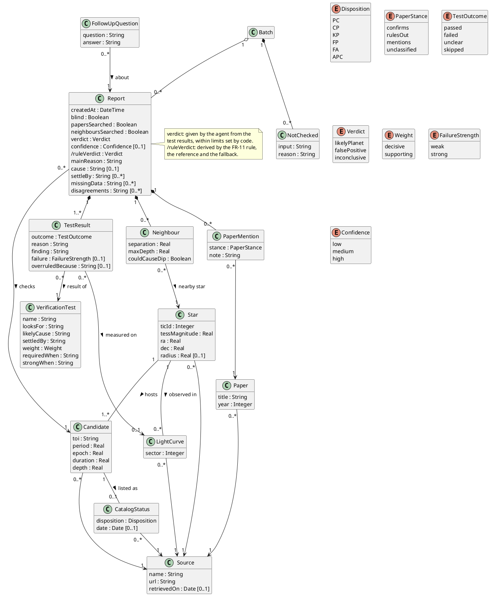

# Domain Model

The domain model names the concepts TESSter works with and how they relate. It follows the [vision](vision.md) and the [use cases](use-cases.md), uses the terms of the [glossary](glossary.md), and refers to the [requirements](requirements.md) by their IDs. It describes the problem, not the code: the agent, its tools and the archive adapters are left out (see [Outside the model](#outside-the-model)).

## Key concepts

| Concept | Meaning | Comes from |
|---|---|---|
| Star | A star in the TESS Input Catalog, identified by its TIC number. It is either the target star of a candidate or a star near it. | UC-01 steps 2, 4 |
| Candidate | A transit signal around a target star, identified by its TOI number. It has the timing (period, epoch, duration) and depth of its dips. | FR-01, UC-01 step 2 |
| Catalog status | The candidate's disposition in the exoplanet catalogs (e.g. *planet candidate*), with its date. | FR-03 |
| Paper | A scientific paper that mentions the candidate, with title and year. | FR-04 |
| Paper mention | What one paper says about the candidate: confirms it, rules it out or only mentions it (or not classified yet). | FR-05 |
| Neighbour | A star near the target, with its distance and whether it is bright enough to cause the dip on its own. | FR-07 |
| Light curve | A record of the target star's brightness over time, from which the tests measure the dips. | UC-01 step 5 |
| Verification test | A kind of check for a false positive (centroid, odd-even depth, secondary eclipse, companion size): what it looks for, the cause it points to and what would settle it. | FR-06, FR-12, FR-13 |
| Test result | The outcome of one test for one candidate: *passed*, *failed*, *unclear* or *skipped*, with the reason and what was found. A failure is weak or strong, and the agent may overrule a weak one. | FR-08, FR-09, FR-17 |
| Report | Everything the user gets from one check of a candidate, including exactly one verdict with its main reason. | FR-10, UC-01 step 8 |
| Verdict | *Likely planet*, *false positive* or *inconclusive*. The agent gives it from the test results, with its confidence, within the limits of FR-17. The fixed rule gives a reference verdict to compare with. | FR-10, FR-11, FR-17 |
| Source | Where a fact comes from: archive name, link and date. | FR-14 |
| Follow-up question | A question the user asks about a report, with the answer. | FR-15, UC-02 |
| Batch | Several candidates checked at once, listed with *likely planet* first. | FR-16, UC-03 |

## Class diagram

The left part of the diagram is what the archives already know: a star hosts one or more candidates (a TOI number ends in `.01`, `.02` and so on), a candidate may have a catalog status, and the star has light curves. The right part is what one check adds: a report about one candidate holds the paper mentions, the neighbours and one result per verification test it ran or skipped. Follow-up questions are asked about a report but are not part of it: they last only for the session (an [open question](requirements.md#open-questions)). Every outside fact points to exactly one source. A batch holds the reports of the candidates it could check and a *not checked* entry, with the reason, for each one it could not (UC-03 2a).

## Design decisions

Each decision gives the problem, the options we considered, what we chose and what follows from it. D1 describes where we are going, as proposed in [the agent's role](agent-role.md): today's code still computes the verdict with the fixed rule alone.

### D1. The agent gives the verdict, within limits that code enforces

- **Problem:** the verdict has to weigh evidence. The fixed rule in FR-11 cannot: any failed test means *false positive*, so every test we add rejects more real planets. At the same time the same data should give the same verdict (NFR-03), and an LLM on its own does not guarantee that.

| Option | For | Against |
|---|---|---|
| Fixed rule only (today's code) | Always the same verdict, easy to explain | Cannot weigh evidence; one weak failed test decides |
| Score with a threshold | Weighs evidence, still repeatable | Weights are hard to choose and hard to explain to a student |
| The agent decides freely | Can weigh evidence and explain it | May change between runs or rely on the catalog and papers instead of the tests |
| **The agent decides, code sets the limits** | Weighs evidence; the rule keeps it in check | Two verdicts to compare and explain |

- **Decision:** the agent gives `verdict` and `confidence` from the test results. Code checks the limits of FR-17: the verdict comes after every required test has a result and never rests on the catalog status or on papers; it may overrule a weak failure, with the reason in `overruledBecause`, but not a strong one; and a *false positive* names a failed test. A verdict that breaks a limit gets a correction. The fixed rule still computes `/ruleVerdict`. It is the reference, and the fallback when the agent gives no valid verdict.
- **Consequences:**
  - The report shows both verdicts when they differ, so the user can see where the agent went beyond the rule.
  - Comparing the two verdicts on the test set tells us how much freedom the agent keeps. NFR-03 must still hold.
  - Each test has to say where a weak failure ends and a strong one begins (`strongWhen`).
  - FR-11 is rewritten and FR-17 added. The README still says that code computes the verdict; it changes together with the code.

### D2. A test is described once, apart from its results

- **Problem:** we have four tests and want more. Every test needs the same texts in several places: what it looks for, the cause a failure points to (FR-12) and what would settle it (FR-13).

| Option | For | Against |
|---|---|---|
| A subclass of `TestResult` per test | Each test has its own typed values | Every new test changes the model; texts are spread over many classes |
| Only a list of test names | Simplest | The same texts are written in many places and drift apart |
| **`VerificationTest` describes the test, `TestResult` records one run** | One place per test; adding a test adds one description | Values of a single test are not typed attributes |

- **Decision:** `VerificationTest` holds what does not change between candidates: name, what it looks for, likely cause, what would settle it, when it is required, when its failure is strong, and its weight. `TestResult` holds what one run found and points to its test.
- **Consequences:**
  - The agent, the fixed rule and the report all read the same description.
  - A new test starts as *supporting*: the fixed rule ignores it until we trust it, but the agent can already weigh it (FR-18).
  - Values such as how far the centroid moved are described in `finding` and not modelled separately.

### D3. Missing data is written down, never shown as a fact

- **Problem:** archives sometimes do not answer, and the data for a test can be missing or too poor (UC-01 \*a, 5a). "No papers mention this candidate" is a fact (UC-01 3a), but "the paper archive did not answer" is not, and the report must not mix them up.

| Option | For | Against |
|---|---|---|
| Leave out what could not be done | Short reports | An unanswered archive looks like "nothing found" |
| Stop the check when any source fails | Never wrong | The user often gets nothing |
| **Record what is missing and why** | The user sees exactly what the verdict rests on | A few more flags and reasons in the model |

- **Decision:** a test that could not be run still gets a result, with the outcome *skipped* and a reason (FR-08). The report says whether papers and neighbours were searched (`papersSearched`, `neighboursSearched`) and lists what is missing (`missingData`, FR-02). Only the exoplanet catalog is essential: without the candidate there is no report, only a *not checked* entry with the reason.
- **Consequences:**
  - A skipped required test makes the fixed rule's verdict *inconclusive*, so a gap in the data does not look like a planet.
  - Every new source has to say whether it could be reached.

## Outside the model

The LLM agent, its tool calls, the step that runs any required test the agent skipped, the archive adapters and the error types are part of how TESSter is built, not of the domain. They will be described with the architecture.
